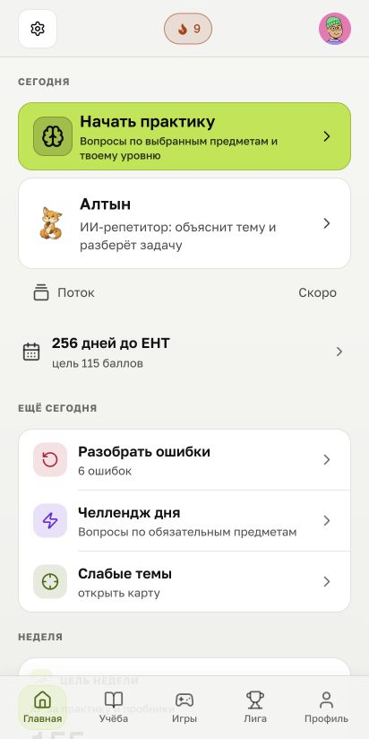
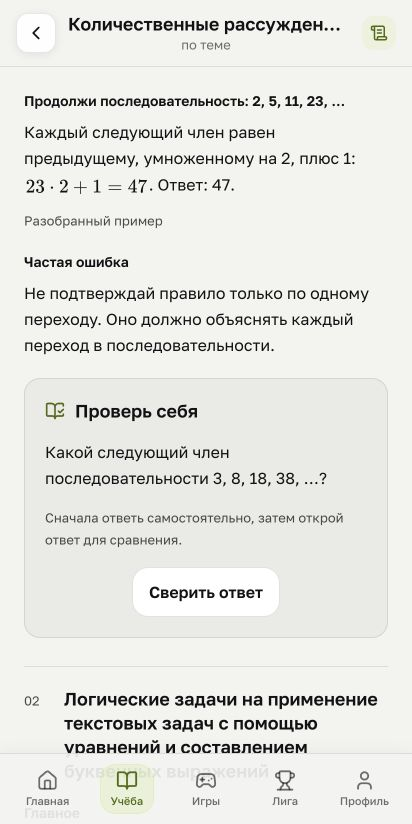
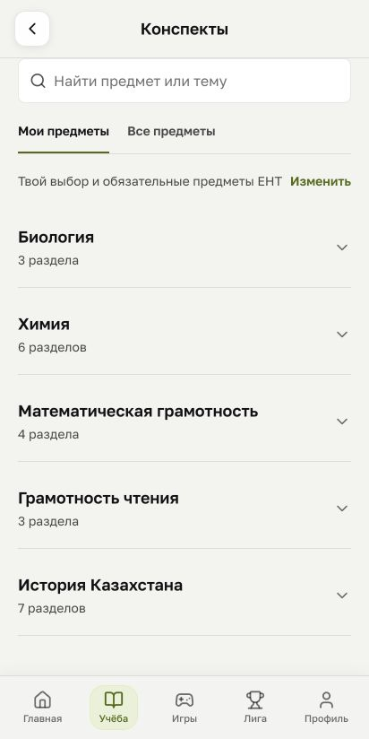
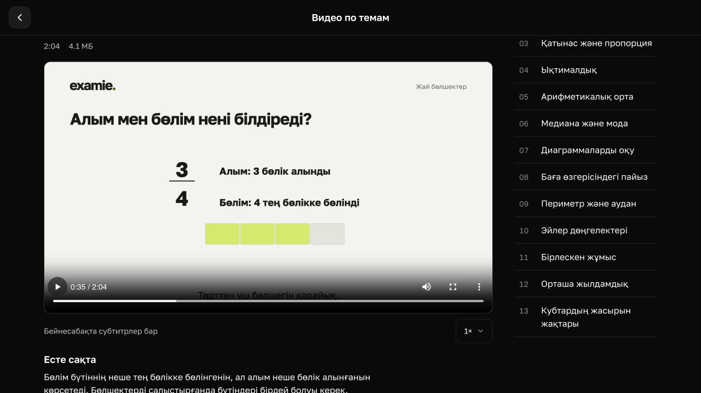
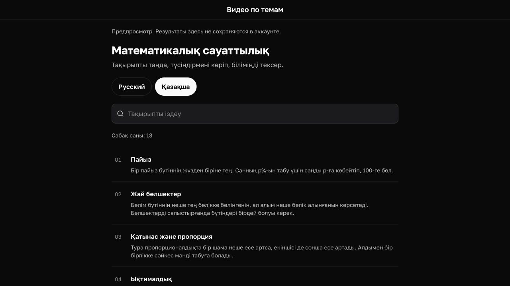
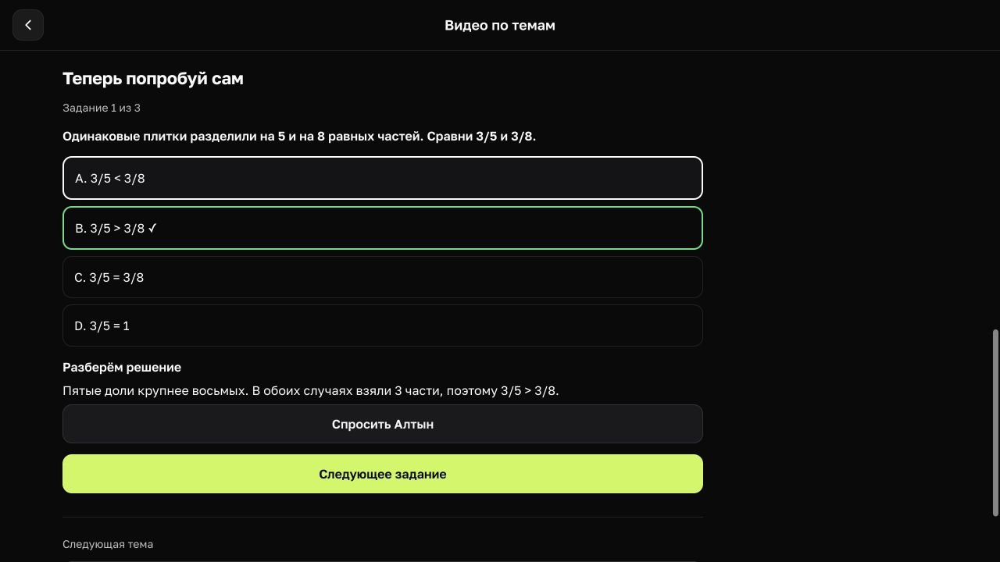
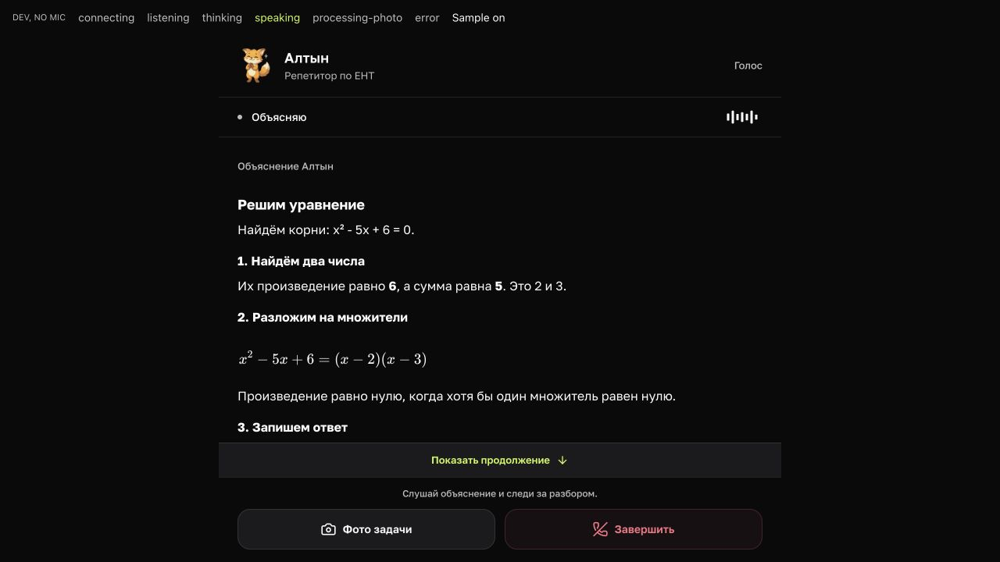

# examie

<p>
  <a href="README.md">English</a>&nbsp;&nbsp;&nbsp;
  <a href="README.kk.md">Қазақша</a>&nbsp;&nbsp;&nbsp;
  <a href="README.ru.md">Русский</a>
</p>

Мен қазақ және орыс тілдерінде ҰБТ-ға дайындалуға арналған examie қолданбасын жасап жатырмын. Онда тақырыптық тапсырмалар, есептердің шешу жолдары және қайталауға арналған материалдар жинақталған.

<p>
  <a href="media/practice-ru.png"></a>
  <a href="media/mistakes-ru.png"></a>
  <a href="media/altyn-ru.png"></a>
</p>

<p>
  <a href="media/home-ru.png"></a>
  <a href="media/notes-ru.png"></a>
  <a href="media/subjects-ru.png"></a>
</p>

Жаттығу, қателермен жұмыс, Алтын, басты экран, конспектілер және пәндер. Жергілікті веб-нұсқада тестілік деректермен 2026 жылғы 30 қыркүйекте түсірілген. [Скриншоттар туралы](media/README.md#қазақша).

## Дайындық қалай өтеді

Оқушы пәндерін таңдап, тақырыптар бойынша тапсырма орындайды. Қате жауап берсе, шешу жолын оқып, қайта орындап көре алады. Түсінбеген қадамын ЖИ-көмекші Алтынмен талқылауға немесе есептің фотосын жіберуге болады.

Қайталауға арналған конспектілер мен қысқа бейнесабақтарда өзіңді тексеруге арналған сұрақтар бар. Оқушы қолданбасын iOS, Android және веб үшін әзірлеп жатырмын. Ата-аналар мен мұғалімдерге бөлек кабинеттер қарастырылған.

### Бейнесабақтар

Сабақтың өз ойнатқышы, қажетті уақытқа өтуге болатын түсіндірме мәтіні және шағын тексеру тапсырмалары бар. Суретте веб-қолданбадағы жай бөлшектер туралы қазақша сабақ көрсетілген.

[](media/video-lesson-kk.jpg)

<details>
<summary>Сабақтар тізімі мен тексеру тапсырмаларын ашу</summary>

Қазақша сабақтар тізімі:

[](media/video-library-kk.jpg)

Орысша тапсырмада әдейі қате жауап таңдалған. Одан кейін шешу жолы көрсетіледі:

[](media/lesson-check-ru.jpg)

</details>

2026 жылғы 24 қазанда жергілікті әзірлеу режимінде түсірілген. Қолданбаның нақты компоненттері мен бейнесабақтары көрсетілген; бұл әрекеттер аккаунтта сақталмайды.

## ЖИ және бейімделетін оқу

### Алтын қалай түсіндіреді

Алтын сыртқы тілдік модельдерді оқу материалдарынан іздеумен (RAG) біріктіреді. Іздеу мағыналық ұқсастық пен толық мәтін бойынша сәйкестікті пайдаланып, пән мен тілді ескереді. Табылған үзінділер түсіндірмеге негіз бола алады. Сәйкес материал табылмаса, жауапты дереккөзбен расталған деп қабылдауға болмайды.

Есепті фото арқылы жіберуге немесе дауыспен сөйлесуге болады. Қолданба сурет пен сөйлеуді тануды, дауыстық жауапты оқу барысымен байланыстырады. Қолдау көрсетілетін математикалық есеп түрлерінде бөлек тексерулер шешімнің жекелеген бөліктерін, соның ішінде кейбір теңдеу қадамдарын тексереді. Олардың қолданылу аясы шектеулі.

[](media/altyn-voice-preview-ru.jpg)

Дауыстық интерфейстің алдын ала көрінісі, 2026 жылғы 24 қазан. Түсіндірме — дайын тестілік мәтін; микрофон мен сөйлеу сервистері қосылмаған. Әзірлеу батырмалары кадрда сақталған.

### Тапсырма таңдау және деңгейді бағалау

Бейімделетін бағалау IRT 2PL моделін қолданады. Жауаптардан кейін оқушы деңгейінің бағасы мен оның белгісіздігі жаңартылады. Келесі тапсырманы таңдағанда оның осы деңгей туралы қаншалықты ақпарат беретіні ескеріледі. Тапсырманың қиындығы ғана жеткіліксіз.

Балл болжамы IRT пен Монте-Карло әдісі арқылы аралық береді. Бұл аралық модель ішіндегі белгісіздікті көрсетеді. Нақты ҰБТ нәтижелерін қаншалықты дәл болжайтынын модельді құруға қатыспаған оқушы нәтижелерімен тексеру әлі қажет.

Бұлар әзірленіп жатқан жобада іске асырылған бөліктер. Алтын сыртқы модельдерді қолданады. Оларды біріктіру, оқу материалдары, іздеу, математикалық тексерулер және бағалау логикасы examie ішінде жасалады.

## Іске қосып көруге болатын код

Бұл мысалдар ашық репозиторий үшін бөлек жазылған және ойдан алынған деректермен жұмыс істейді. Қолданбаның бастапқы коды жабық күйінде қалады.

### Қиындық оқушы деңгейіне байланысты

Бір тапсырмаға дұрыс жауап беру ықтималдығы барлық оқушы үшін бірдей болмауы керек. Шағын 2PL мысалы бағаланған деңгейді тапсырманың қиындығы мен ажырату қабілетімен байланыстырады:

```js
const logit = discrimination * (ability - difficulty);
const tail = Math.exp(-Math.abs(logit));
return logit >= 0 ? 1 / (1 + tail) : tail / (1 + tail);
```

Бұл есептеу тәсілі экспонентаның сандық толып кетуін болдырмайды. Деңгей мен қиындық тең болса, нәтиже 50% болады. Параметрлер ойдан алынған; мысал модельді үйретпейді және емтихан балын болжамайды. [Толық мысал](examples/item-response/probability.mjs), [тесттер](examples/item-response/probability.test.mjs) және [түсіндірме мен іске қосу нұсқаулығы](examples/item-response/README.md) осында.

### Қайта қаралған уақыт

Алдымен 0–30 секундты, кейін 20–50 секундты қарасаң, сабақтың 60 емес, 50 секундын көресің. Уақыт аралықтарын тексеріп, бейненің ұзақтығымен шектеп, реттегеннен кейін мына есептеу қалады:

```js
let watched = 0;
let coveredUntil = 0;

for (const [start, end] of ranges) {
  watched += Math.max(0, end - Math.max(start, coveredUntil));
  coveredUntil = Math.max(coveredUntil, end);
}
```

Бастапқы массив өзгермейді, өткізіп жіберген бөліктер қаралды деп саналмайды. [Толық мысал](examples/lesson-progress/progress.mjs), [тесттер](examples/lesson-progress/progress.test.mjs) және [іске қосу нұсқаулығы](examples/lesson-progress/README.md#run) осында.

### Кеш келген жауап

A тапсырмасының түсіндірмесі жүктеліп жатқанда оқушы B тапсырмасына өтті. Ескі жауап жаңа жауапты алмастырмауы керек. Алдымен бұрынғы операцияны тоқтатуға сигнал береміз, содан кейін экранды жаңартпас бұрын сұраудың нөмірін тексереміз. Операция тоқтату сигналын елемеуі мүмкін, сондықтан бұл тексеру қажет.

```js
const value = await load(controller.signal);

if (requestId !== currentId) return "discarded";

apply(value);
return "applied";
```

Экраннан шыққанда да күтіліп жатқан сұрау жарамсыз болады. Соңғы сұраудың қатесі шақырған кодқа беріледі: экран қатені көрсетіп, қайта жүктеуді ұсына алады. [Толық мысал](examples/latest-request/latest-request.mjs), [тесттер](examples/latest-request/latest-request.test.mjs) және [іске қосу нұсқаулығы](examples/latest-request/README.md#run) осында.

Үш мысал да Node.js 22 немесе одан жаңа нұсқамен жергілікті іске қосылады. Пакет орнату, кілт енгізу немесе желіге қосылу қажет емес.

## Әзірлеу

Оқушы қолданбасы React Native, Expo және TypeScript арқылы жасалған. Веб-кабинеттерде Next.js, серверде PostgreSQL және Redis-пен бірге NestJS пен FastAPI қолданылады.

Жоба әзірленіп жатыр. Әзірге ашық демо-нұсқасы мен қолданбаны жүктеу сілтемесі жоқ.

[Влад Слугин](https://github.com/vladslugin). Жоба туралы сұрақтарың мен ұсыныстарыңды [Issues](https://github.com/vladslugin/examie/issues) бөліміне жаза аласың.
