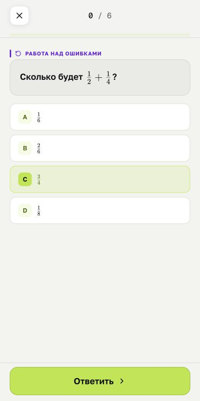
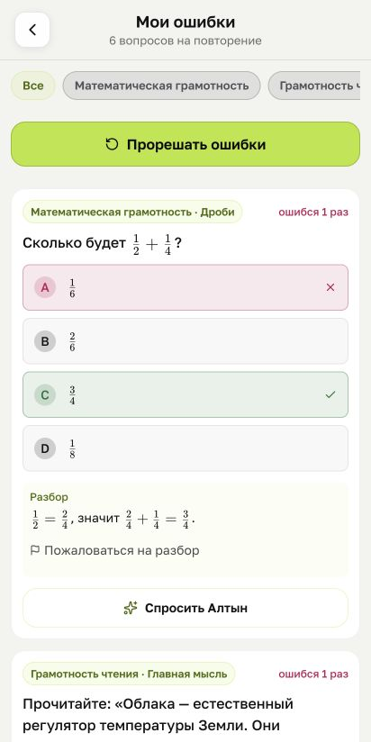
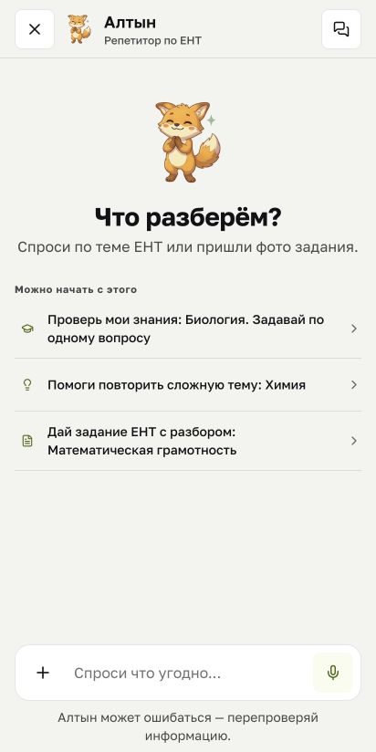

# examie

**[English](README.md) · [Қазақша](README.kk.md) · [Русский](README.ru.md)**

Preparation for Kazakhstan’s national university entrance exam (UNT), in Kazakh and Russian.

I’m building examie around a simple study routine: try a question, understand a mistake, then come back to it. Practice, explanations and revision belong in the same place.

This repository is a public look at the project. It contains screenshots and a small, runnable code example. The application source is kept private.

## Inside the app

<p>
  <a href="media/practice-ru.png"></a>
  <a href="media/mistakes-ru.png"></a>
  <a href="media/altyn-ru.png"></a>
</p>

Practice → review the explanation → ask Altyn for help.

These captures show the Russian interface in a local web build on **30 September 2026**, using test data. They are not phone captures or a live AI conversation. The interface has continued to change since then. [Details about the screenshots](media/README.md).

## What I’m building

- **Practice by topic.** Work through questions in the subjects you’re preparing for.
- **Mistake review.** See your answer beside the correct one, read the explanation and try again.
- **Altyn.** An AI tutor for discussing a topic or a question, including one sent as a photo. Its answers can be wrong, so they need checking.
- **Revision.** Topic notes, short video lessons and self-check questions.

The student app targets iOS, Android and the web. The wider project also includes parent and teacher interfaces.

## A small code example

[Lesson progress](examples/lesson-progress/README.md) counts how much of a video has been watched without counting repeated sections twice. It covers overlapping intervals, seeking and the end of a video.

I wrote it separately for this repository. It uses made-up playback data and has no connection to the application’s API or progress storage.

With Node.js 22 or newer, from the repository root:

```sh
node examples/lesson-progress/demo.mjs
node --test examples/lesson-progress/progress.test.mjs
```

No packages or credentials are needed. [Read the example](examples/lesson-progress/progress.mjs).

## Built with

| Part           | Tools                                       |
| -------------- | ------------------------------------------- |
| Student app    | React Native, Expo, TypeScript              |
| Web interfaces | Next.js, React                              |
| Server         | NestJS, Python / FastAPI, PostgreSQL, Redis |

These are the tools used in the private application. This repository only contains the showcase materials and standalone example.

## Project status

examie is under development. The screenshots document a local build; this repository does not currently offer a hosted demo or a public app download.

Built by [Vlad Slugin](https://github.com/vladslugin). Feedback on the study flow or wording in Kazakh and Russian is welcome in [Issues](https://github.com/vladslugin/examie/issues).
